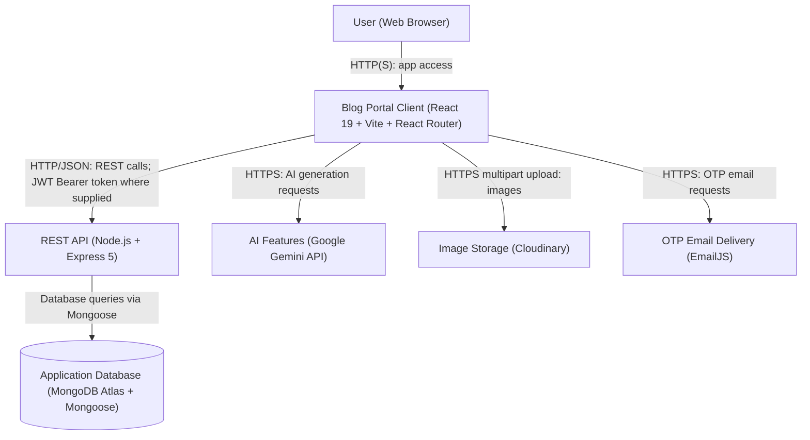

# Blog Portal

A full-stack blog and collaboration portal with user authentication, post creation, comments, likes, saves, notifications, profile management, collaboration requests, and admin moderation.

## Project Overview

Blog Portal is built as a two-part application:

- `backend/` - Express.js + MongoDB API server
- `frontend/` - React + Vite client application

The app supports:
- user login/register
- blog posting with images
- likes, saves, shares
- comments and comment replies
- profile editing, follow/unfollow
- collaboration invitations
- notifications
- admin moderation for posts/comments
- AI tag suggestion and content moderation integration

## System Architecture

## Tech Stack

### Backend
- Node.js
- Express
- MongoDB / Mongoose
- JSON Web Tokens
- dotenv
- cors

### Frontend
- React 19
- Vite
- React Router Dom
- Zustand
- Axios
- MUI Material
- Framer Motion
- React Toastify
- React Quill
- Google Generative AI client
- Cloudinary file upload helpers

## Project Structure

### Backend
- `backend/app.js`
- `backend/controllers/`
- `backend/models/`
- `backend/middleware/`

### Frontend
- `frontend/src/`
  - `components/`
  - `screens/`
  - `router/`
  - `utils/`
  - `data/`
  - `assets/`

## Developer
* **Full-Stack Development** - Bhadri Prabhu K
